# EV Charging Application — UI/UX Design Showcase

A visual showcase of the EV Charging Application screens, exported from Figma. This repository section documents the app's screen designs and provides a starting point for reviewing the intended user experience.

## 🔗 Design Links

- **Figma design file:** [Open the Figma design](YOUR_FIGMA_FILE_LINK)
- **Interactive prototype:** [Explore the prototype](YOUR_FIGMA_PROTOTYPE_LINK)

> Replace the placeholder URLs above with your share links. Check the Figma sharing permissions so intended viewers can open them.

## 📱 Screen Gallery

The screen exports are stored in [`docs/design/screens/`](docs/design/screens/). The gallery below uses relative image paths so the images render directly on GitHub.

### 1. Launch and Onboarding

| Splash screen | Onboarding 1 | Onboarding 2 |
|---|---|---|
|  | 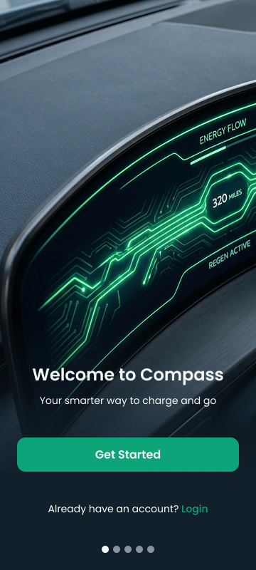 | 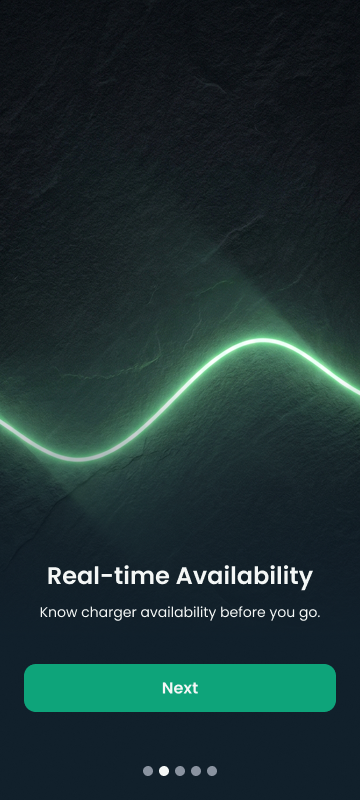 |

| Onboarding 3 | Welcome |
|---|---|
| 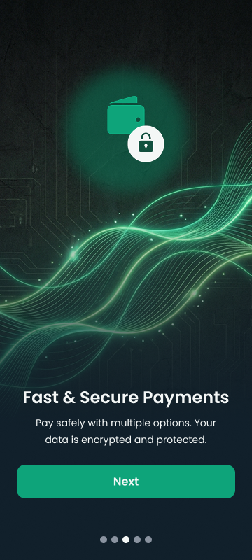 | 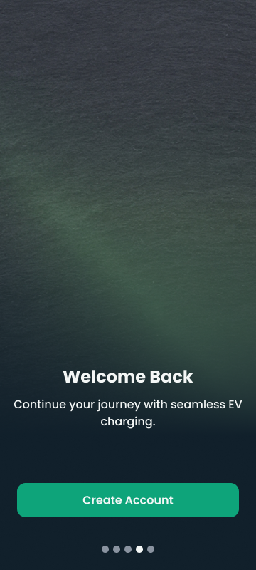 |

### 2. Authentication and Vehicle Setup

| Login | OTP verification |
|---|---|
| 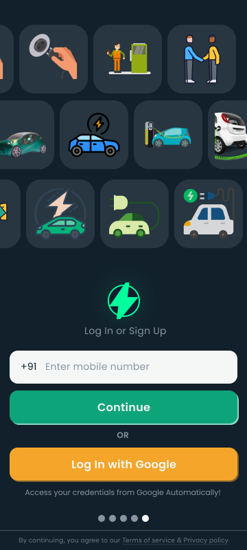 |  |

| Select vehicle brand | Select vehicle model |
|---|---|
|  |  |

| Select vehicle location | Select vehicle year | Payment |
|---|---|---|
|  |  | 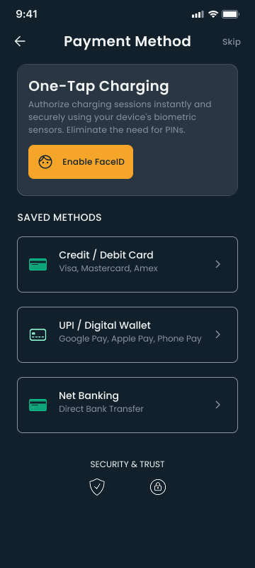 |

### 3. Home and Charging Flow

| Home | Scan for charge | Charging complete |
|---|---|---|
| 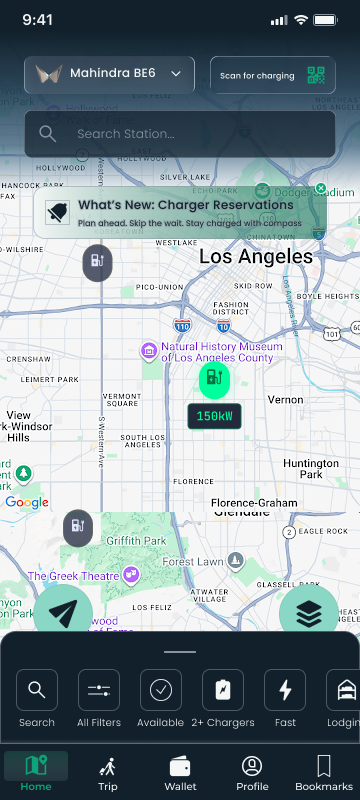 |  |  |

| Home popup | Popup section | Submit details | Done |
|---|---|---|---|
|  |  |  | 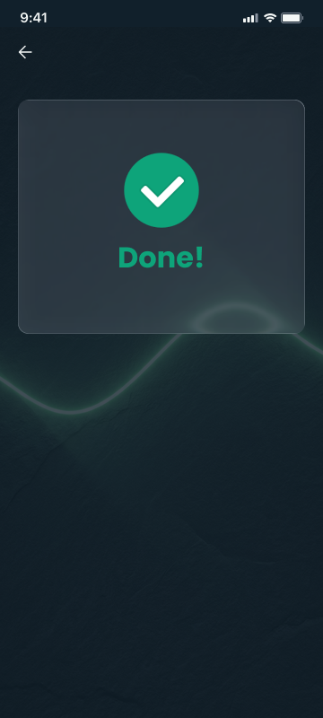 |

### 4. Trips, Wallet, Profile, and Sessions

| Trip | Wallet | Profile |
|---|---|---|
| 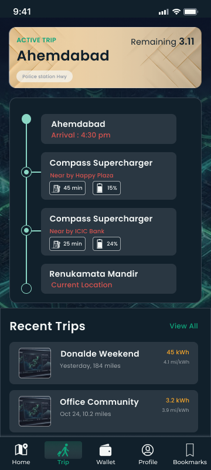 | 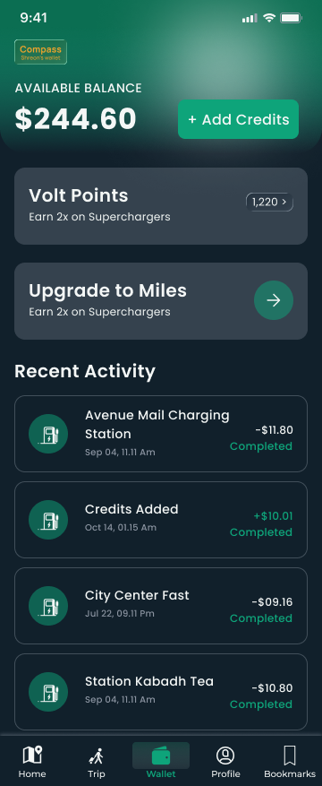 | 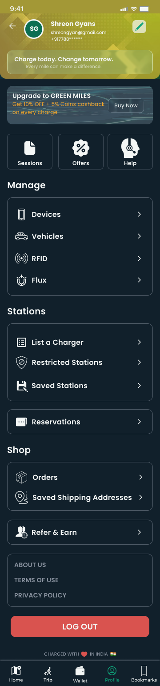 |

| Session screen 1 | Session screen 2 |
|---|---|
| 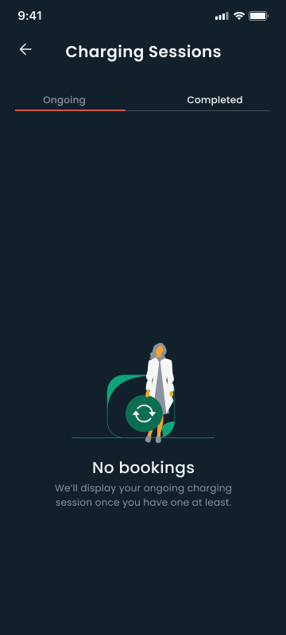 | 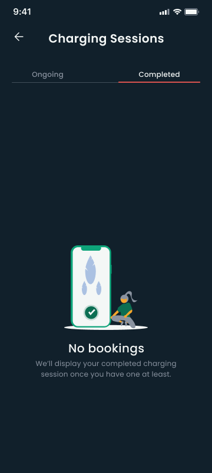 |

### 5. Offers and Help

| Offers screen 1 | Offers screen 2 | Offers screen 3 |
|---|---|---|
|  | 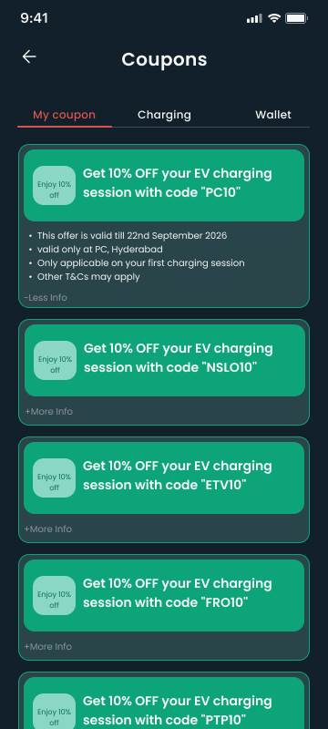 | 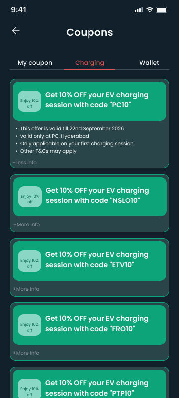 |

| Offers screen 4 | Help |
|---|---|
| 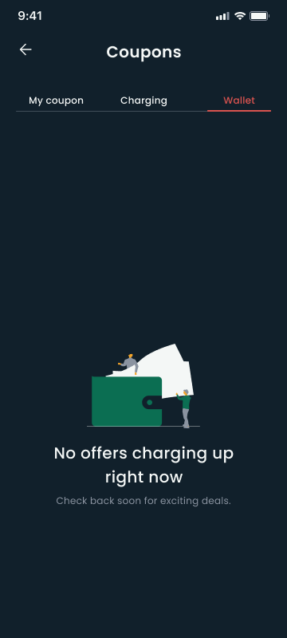 | 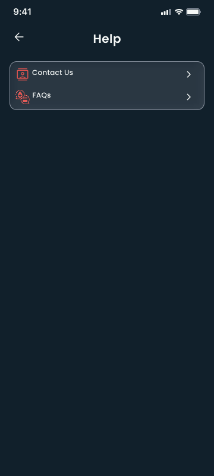 |

### 6. Device, Vehicle, RFID, and Station Management

| Manage device | Manage vehicle | Manage RFID |
|---|---|---|
|  |  |  |

| Manage flux | Station list / chargers | Restricted stations |
|---|---|---|
|  |  |  |

### 7. OTP, Saved Stations, and Reservations

| Confirm OTP | Saved station |
|---|---|
|  |  |

| Reservation screen 1 | Reservation screen 2 |
|---|---|
| 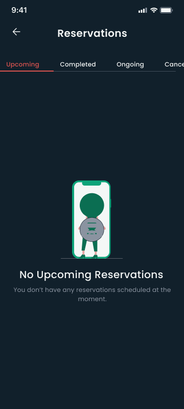 | 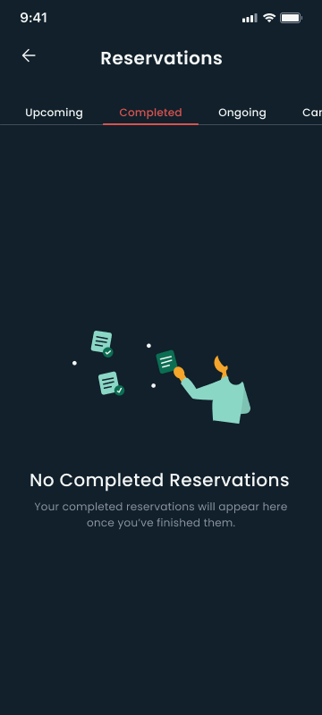 |

| Reservation screen 3 | Reservation screen 4 |
|---|---|
| 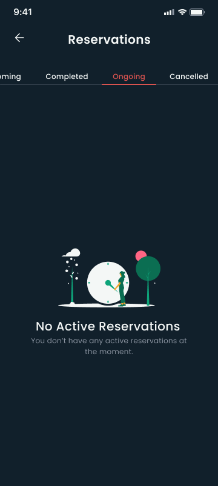 | 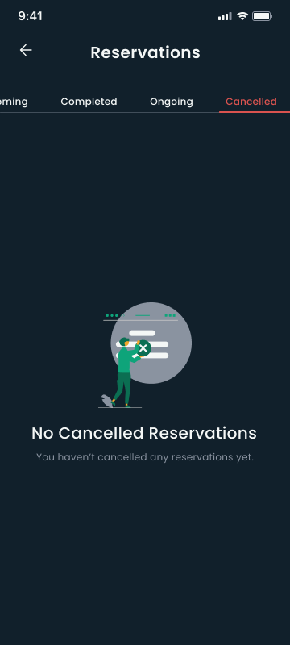 |

### 8. Shop Orders and Referrals

| Shop orders 1 | Shop orders 2 | Refer and earn |
|---|---|---|
|  |  |  |

### 9. About, Policies, and Bookmarks

| About us | Terms of use | Privacy policy |
|---|---|---|
|  |  |  |

| Bookmarks screen 1 | Bookmarks screen 2 |
|---|---|
| 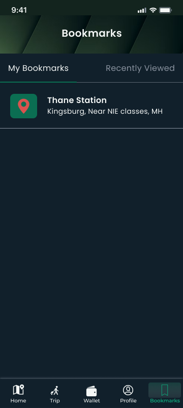 | 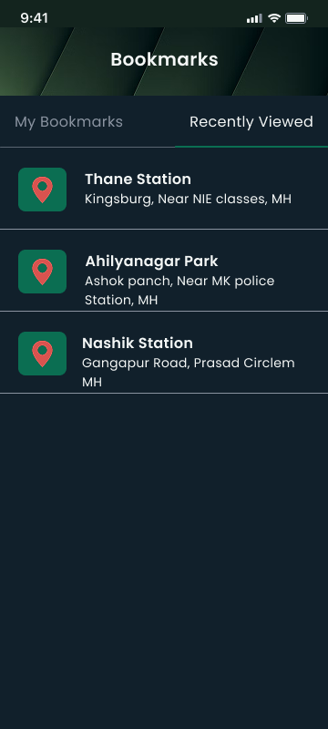 |

### 10. Additional Frames

The following exported frames were included in the provided screen list. Their exact purpose was not specified, so they are listed by their original filenames.

| Additional frame |
|---|
| [Frame 2085663355.png](docs/design/screens/Frame%202085663355.png) |
| [Frame 2085663359.png](docs/design/screens/Frame%202085663359.png) |
| [Frame 2085663360.png](docs/design/screens/Frame%202085663360.png) |
| [Frame 2085663361.png](docs/design/screens/Frame%202085663361.png) |

## 🗂️ Design Asset Structure

```text
docs/
└── design/
    └── screens/
        ├── 01-splash screen.png
        ├── 02-onboarding1.png
        ├── 03-onboarding2.png
        ├── ...
        └── 49-bookmarks.png
```

Keep the filenames consistent with the links in this README. If you rename a file, update its corresponding image path here.

## 👀 Viewing the Designs

- **Browse the gallery:** Scroll through the screen previews above.
- **Inspect an individual screen:** Click an image to open it at a larger size on GitHub.
- **Explore interactions:** Use the Figma prototype link above once it has been added.

## 📝 Notes

- These are exported design screens; they do not by themselves represent a running application.
- The interactive prototype is available only after a valid Figma prototype link is added.
- Make sure you have permission to publish these designs in a public repository before making the repository public.
